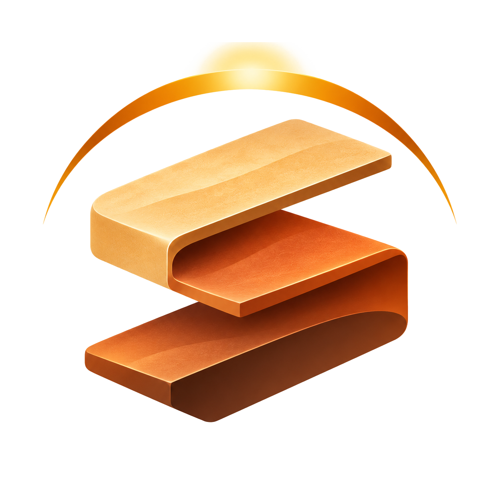

# ☀️ SUN Product Ecosystem

**One source. Many independent products.**

This repository is the canonical reference for SUN product naming, brand architecture, visual identity direction, product registry, and recorded branding decisions. It does **not** contain application implementation or development milestones.

## SUN parent identity

The approved parent-brand banner and [symbol](branding/assets/symbol.png) represent the SUN product family. Compact SVGs are simplified adaptations of the approved symbol. See the [SUN Parent Brand Guide](branding/BRAND-GUIDE.md).

Earlier exploratory artwork remains documented in [Visual Identity Concept 01](branding/VISUAL-CONCEPT-01.md); the concept records early proposals and historical branding explorations.

<!-- SUN-REPOSITORY-GALLERY:START -->
## SUN Repository Gallery

Generated from [the repository catalog](registry/repositories.json). Approved identities remain governed by [products.json](registry/products.json).

### Products

<table>
<tr>
<td align="center" width="180">
<strong>Outpost</strong>
<small>SUN-C001 · Identity, authentication, authorization and security</small></td>
<td align="center" width="180">
<strong>Workbench</strong>
<small>SUN-P001 · Local code organizer and interactive scripting workspace</small></td>
</tr>
</table>

### Infrastructure

<table>
<tr>
<td align="center" width="180">
<strong>Foundry</strong>
<small>SUN-G003 · Repository factory and governance verification</small></td>
<td align="center" width="180"><a href="https://github.com/sunstriker2009/sun-foundry-pilot"><strong>Foundry Pilot</strong></a>
<strong>Foundry Pilot</strong>
<small>SUN-G004 · Isolated repository for validating Foundry provisioning and inherited branding</small></td>
<td align="center" width="180">
<strong>Strata</strong>
<small>SUN-G002 · Reusable repository template</small></td>
</tr>
</table>
<!-- SUN-REPOSITORY-GALLERY:END -->

## Ecosystem at a glance

See the [ecosystem relationship diagram](docs/architecture/ECOSYSTEM-MAP.md) for confirmed products, shared repository infrastructure and the independent MarketPilot AI integration target.

| Area | Component | Role |
|---|---|---|
| Governance | **SUN Ecosystem** | SUN-G001 — naming, registry, branding and governance |
| Repository infrastructure | [Strata](https://github.com/sunstriker2009/sun-strata) | SUN-G002 — reusable repository foundation |
| Repository infrastructure | [Foundry](https://github.com/sunstriker2009/sun-foundry) | SUN-G003 — repository factory and governance verification |
| Confirmed product | [Outpost](https://github.com/sunstriker2009/sun-outpost) | Identity and security platform — SUN-C001 |
| Confirmed product | [Workbench](https://github.com/sunstriker2009/sun-workbench) | Scripting workspace — SUN-P001 |
| Independent application | [MarketPilot AI](https://github.com/sunstriker2009/sun-marketpilot-ai) | Planned Outpost integration target; not a registered SUN product |

SUN Ecosystem, Strata, Foundry, and Foundry Pilot are tracked in the [governance and infrastructure registry](registry/INFRASTRUCTURE.md) using the separate SUN-G series.

## Confirmed products

**Outpost by Sun** — Identity. Trust. Protection.  
Reusable authentication, authorization, identity and security platform.  
Registry: **SUN-C001 — CONFIRMED**. Commercial naming clearance is **pending**.

Outpost supersedes ORYVA, which previously superseded HALO. The [sun-outpost](https://github.com/sunstriker2009/sun-outpost) repository uses the `Sun.Security` technical identity. MarketPilot AI is an independent application and initial integration target.

**Workbench by Sun** — Organize. Script. Explore.  
Local code organizer and interactive scripting workspace, with language-aware editing and planned JavaScript, Python and C# runtime adapters.  
Registry: **SUN-P001 — CONFIRMED**. Technical identity: `Sun.Workspace`. Repository established; commercial clearance remains pending.

## Documentation

| Document | Purpose |
|---|---|
| [Brand Guidelines v2.0](branding/BRAND-GUIDELINES.md) | SUN positioning, brand architecture and product-family visual themes |
| [Reusable Prompts](docs/prompts/README.md) | Copyable collaboration prompts, including thread continuation handoffs |
| [SUN Workflow Handbook](docs/workflows/README.md) | Central catalog of shared SUN workflows, triggers, permissions, approval gates and operator recipes |
| [Repository Factory](https://github.com/sunstriker2009/sun-foundry) | Automated repository creation, CI initialization, governance application, verification and recovery |
| [Strata — Repository Foundation](https://github.com/sunstriker2009/sun-strata) | Standard starting structure and CI workflows for new SUN repositories |
| [Git Workflow & Merge Policy v1.0](docs/governance/GIT-WORKFLOW.md) | Authoritative cross-repository PR, squash merge, CI, review and release governance |
| [Naming Guidelines v1.0](branding/NAMING-GUIDELINES.md) | Naming rules, scoring, workflow and clearance |
| [Product Repository Branding Standard v2.0](docs/governance/PRODUCT-BRANDING.md) | Approved concept workflow, README banners, PNG assets, optional SVG adaptations and existing-repository adoption checklist |
| [Visual Identity](branding/VISUAL-IDENTITY.md) | Provisional palette, typography and logo direction |
| [Outpost product documentation](https://github.com/sunstriker2009/sun-outpost) | Architecture, design system, engineering roadmap and implementation (maintained outside SUN ecosystem) |
| [Visual Identity Concept 01](branding/VISUAL-CONCEPT-01.md) | Artwork and design exploration |
| [Product Registry](registry/PRODUCTS.md) | Confirmed and proposed product names |
| [Governance & Infrastructure Registry](registry/INFRASTRUCTURE.md) | SUN-G001 through SUN-G004, separate from product IDs |
| [Ecosystem Map](docs/architecture/ECOSYSTEM-MAP.md) | Mermaid diagram of current organizational relationships |
| [Machine-readable Registry](registry/products.json) | Structured product metadata |
| [Brand Architecture Decision](decisions/0001-sun-brand-architecture.md) | Endorsed brand model |
| [Outpost naming decision](decisions/product-renames/sun-001-outpost.md) | ORYVA → Outpost and SUN-C001 continuity |
| [Product Ideas](docs/product-ideas.md) | Early concepts and product direction |
| [Product Proposal Template](templates/PRODUCT-PROPOSAL.md) | Starting new proposals |
| [Naming Review Template](templates/NAMING-REVIEW.md) | Candidate evaluation and clearance |
| [Workbench naming decision](decisions/0004-workbench-rename.md) | SUN-P001 approval and naming rationale |
| [Changelog](CHANGELOG.md) | Version history |

## Registry status

**Confirmed products:** Outpost (SUN-C001), Workbench (SUN-P001). **Governance & infrastructure:** SUN Ecosystem (SUN-G001), Strata (SUN-G002), Foundry (SUN-G003), Foundry Pilot (SUN-G004).  
**Unnumbered proposals:** ORBIT, NOVA, PRISM, PULSAR, LUMEN, BEACON, FORGE. Proposed names have no reserved SUN IDs and must not trigger automatic project creation. The next IDs are **SUN-P002** for productivity, **SUN-C002** for application components, and **SUN-G005** for governance and infrastructure.

## Product repository branding

SUN product repositories follow the [Product Repository Branding Standard](docs/governance/PRODUCT-BRANDING.md): product-family visual themes, purpose-led symbols with a visual connection to SUN, distinct palettes, approved panoramic README banners and coordinated PNG compact assets, with optional SVG adaptations. [Workbench](https://github.com/sunstriker2009/sun-workbench) and [Outpost](https://github.com/sunstriker2009/sun-outpost) are reference examples; existing repositories should track adoption independently.

## Repository provisioning

Use [Foundry — Repository Factory](https://github.com/sunstriker2009/sun-foundry) to create and initialize new SUN repositories from the [Strata template](https://github.com/sunstriker2009/sun-strata). The Factory provisions CI and governance, verifies supported enforcement, and supports resuming interrupted setup. [Repository Maintenance](https://github.com/sunstriker2009/sun-foundry/actions/workflows/repository-factory-resume.yml) handles existing-repository diagnosis and governance changes. For operation and limitations, see the [Factory workflow guide](https://github.com/sunstriker2009/sun-foundry/blob/main/docs/WORKFLOWS.md). Private repositories on unsupported GitHub plans cannot be treated as strictly verified; the Factory fails closed in that case.

## Governance

Names become confirmed only after explicit owner approval. Internal naming approval does not imply trademark, domain, NuGet, npm, or GitHub availability. Visual colors and marks are provisional unless expressly approved. All changes follow the [SUN Git Workflow & Merge Policy v1.0](docs/governance/GIT-WORKFLOW.md): protected `main`, pull requests, passing required CI, applicable review, **squash-only merges**, and automatic branch cleanup. Record substantive brand decisions under `decisions/`.

**Branding policy version:** 2.0 — 2026-11-18.

## Resuming governance work

Read the [governance handoff](docs/governance/HANDOFF.md) for verified evidence, pending validation, cross-repository responsibilities and resume boundaries before continuing after thread archival.
