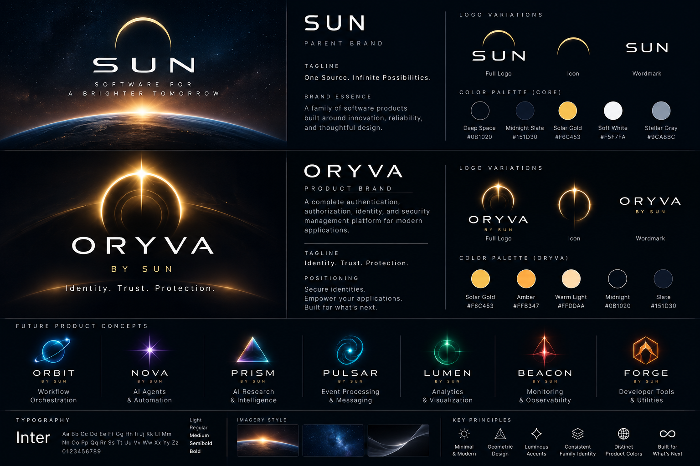

# ☀️ SUN Product Ecosystem

**One source. Many independent products.**

This repository is the canonical reference for SUN product naming, brand architecture, visual identity direction, product registry, and recorded branding decisions. It does **not** contain application implementation or development milestones.

## Visual identity — Concept 01

Explore the [concept notes](branding/VISUAL-CONCEPT-01.md). This is an **exploratory concept**, not a finalized production logo. The other product names pictured remain proposals only.

## Current confirmed product

**ORYVA by Sun** — Identity. Trust. Protection.  
Reusable authentication, authorization, identity and security platform.  
Registry: **SUN-001 — CONFIRMED**. Commercial naming clearance is **pending**.

ORYVA supersedes the earlier name HALO. Technical naming remains `Sun.Security`; product repository: [sun-oryva](https://github.com/sunstriker2009/sun-oryva). MarketPilot AI is an independent application and initial integration target.

## Documentation

| Document | Purpose |
|---|---|
| [Brand Guidelines](branding/BRAND-GUIDELINES.md) | SUN vision, positioning and architecture |
| [Naming Guidelines v1.0](branding/NAMING-GUIDELINES.md) | Naming rules, scoring, workflow and clearance |
| [Visual Identity](branding/VISUAL-IDENTITY.md) | Provisional palette, typography and logo direction |
| [ORYVA product documentation](https://github.com/sunstriker2009/sun-oryva) | Architecture, design system, engineering roadmap and implementation (maintained outside SUN ecosystem) |
| [Visual Identity Concept 01](branding/VISUAL-CONCEPT-01.md) | Artwork and design exploration |
| [Product Registry](registry/PRODUCTS.md) | Confirmed and proposed product names |
| [Machine-readable Registry](registry/products.json) | Structured product metadata |
| [Brand Architecture Decision](decisions/0001-sun-brand-architecture.md) | Endorsed brand model |
| [HALO → ORYVA Decision](decisions/0002-halo-to-oryva.md) | Historical rename rationale |
| [Product Proposal Template](templates/PRODUCT-PROPOSAL.md) | Starting new proposals |
| [Naming Review Template](templates/NAMING-REVIEW.md) | Candidate evaluation and clearance |
| [Changelog](CHANGELOG.md) | Version history |

## Registry status

**Confirmed:** ORYVA.  
**Proposed only:** ORBIT, NOVA, PRISM, PULSAR, LUMEN, BEACON, FORGE. These are not approved products and must not trigger automatic project creation.

## Governance

Names become confirmed only after explicit owner approval. Internal naming approval does not imply trademark, domain, NuGet, npm, or GitHub availability. Visual colors and marks are provisional unless expressly approved. Use feature branches and pull requests with **squash merges** to propose changes and record substantive decisions under `decisions/`.

**Guidelines version:** 1.0 — 2026-10-30.
