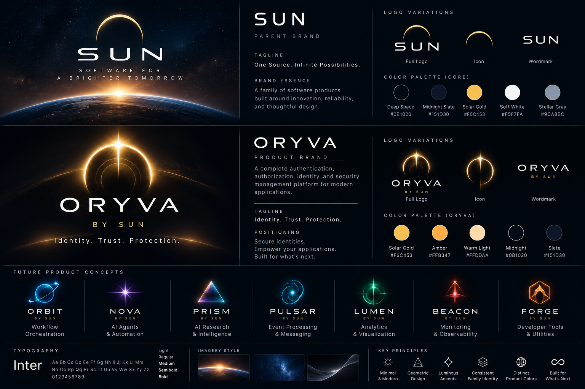

# ☀️ SUN Product Ecosystem

**One source. Many independent products.**

This repository is the canonical reference for SUN product naming, brand architecture, visual identity direction, product registry, and recorded branding decisions. It does **not** contain application implementation or development milestones.

## Visual identity — Concept 01

Explore the [concept notes](branding/VISUAL-CONCEPT-01.md). This is an **exploratory concept**, not a finalized production logo. The other product names pictured remain proposals only.

## Confirmed products

**ORYVA by Sun** — Identity. Trust. Protection.  
Reusable authentication, authorization, identity and security platform.  
Registry: **SUN-001 — CONFIRMED**. Commercial naming clearance is **pending**.

ORYVA supersedes the earlier name HALO. Technical naming remains `Sun.Security`; product repository: [sun-oryva](https://github.com/sunstriker2009/sun-oryva). MarketPilot AI is an independent application and initial integration target.

**ASTELVO by Sun** — Organize. Script. Explore.  
Local code organizer and interactive scripting workspace, with language-aware editing and planned JavaScript, Python and C# runtime adapters.  
Registry: **SUN-009 — CONFIRMED**. Technical identity: `Sun.Workspace`. Repository established; commercial clearance remains pending.

## Documentation

| Document | Purpose |
|---|---|
| [Brand Guidelines](branding/BRAND-GUIDELINES.md) | SUN vision, positioning and architecture |
| [Repository Factory](https://github.com/sunstriker2009/sun-foundry) | Automated repository creation, CI initialization, governance application, verification and recovery |
| [Repository Template](https://github.com/sunstriker2009/sun-repo-template) | Standard starting structure and CI workflows for new SUN repositories |
| [Git Workflow & Merge Policy v1.0](docs/governance/GIT-WORKFLOW.md) | Authoritative cross-repository PR, squash merge, CI, review and release governance |
| [Naming Guidelines v1.0](branding/NAMING-GUIDELINES.md) | Naming rules, scoring, workflow and clearance |
| [Product Repository Branding Standard](docs/governance/PRODUCT-BRANDING.md) | Approved concept workflow, README banners, SVG assets and existing-repository adoption checklist |
| [Visual Identity](branding/VISUAL-IDENTITY.md) | Provisional palette, typography and logo direction |
| [ORYVA product documentation](https://github.com/sunstriker2009/sun-oryva) | Architecture, design system, engineering roadmap and implementation (maintained outside SUN ecosystem) |
| [Visual Identity Concept 01](branding/VISUAL-CONCEPT-01.md) | Artwork and design exploration |
| [Product Registry](registry/PRODUCTS.md) | Confirmed and proposed product names |
| [Machine-readable Registry](registry/products.json) | Structured product metadata |
| [Brand Architecture Decision](decisions/0001-sun-brand-architecture.md) | Endorsed brand model |
| [HALO → ORYVA Decision](decisions/0002-halo-to-oryva.md) | Historical rename rationale |
| [Product Proposal Template](templates/PRODUCT-PROPOSAL.md) | Starting new proposals |
| [Naming Review Template](templates/NAMING-REVIEW.md) | Candidate evaluation and clearance |
| [ASTELVO naming decision](decisions/0003-astelvo-script-workspace.md) | SUN-009 approval and naming rationale |
| [Changelog](CHANGELOG.md) | Version history |

## Registry status

**Confirmed:** ORYVA, ASTELVO. FOUNDRY is the SUN repository-provisioning tool.  
**Proposed only:** ORBIT, NOVA, PRISM, PULSAR, LUMEN, BEACON, FORGE. These are not approved products and must not trigger automatic project creation.

## Product repository branding

SUN product repositories follow the [Product Repository Branding Standard](docs/governance/PRODUCT-BRANDING.md): purpose-led symbols incorporating SUN's arc, distinct palettes, approved panoramic README banners and coordinated compact SVG variants. [ASTELVO](https://github.com/sunstriker2009/sun-astelvo) and [ORYVA](https://github.com/sunstriker2009/sun-oryva) are reference examples; existing repositories should track adoption independently.

## Repository provisioning

Use [Repository Factory](https://github.com/sunstriker2009/sun-foundry) to create and initialize new SUN repositories from the [standard template](https://github.com/sunstriker2009/sun-repo-template). The Factory provisions CI and governance, verifies supported enforcement, and supports resuming interrupted setup. [Repository Maintenance](https://github.com/sunstriker2009/sun-foundry/actions/workflows/repository-factory-resume.yml) handles existing-repository diagnosis and governance changes. For operation and limitations, see the [Factory workflow guide](https://github.com/sunstriker2009/sun-foundry/blob/main/docs/WORKFLOWS.md). Private repositories on unsupported GitHub plans cannot be treated as strictly verified; the Factory fails closed in that case.

## Governance

Names become confirmed only after explicit owner approval. Internal naming approval does not imply trademark, domain, NuGet, npm, or GitHub availability. Visual colors and marks are provisional unless expressly approved. All changes follow the [SUN Git Workflow & Merge Policy v1.0](docs/governance/GIT-WORKFLOW.md): protected `main`, pull requests, passing required CI, applicable review, **squash-only merges**, and automatic branch cleanup. Record substantive brand decisions under `decisions/`.

**Guidelines version:** 1.0 — 2026-10-30.
