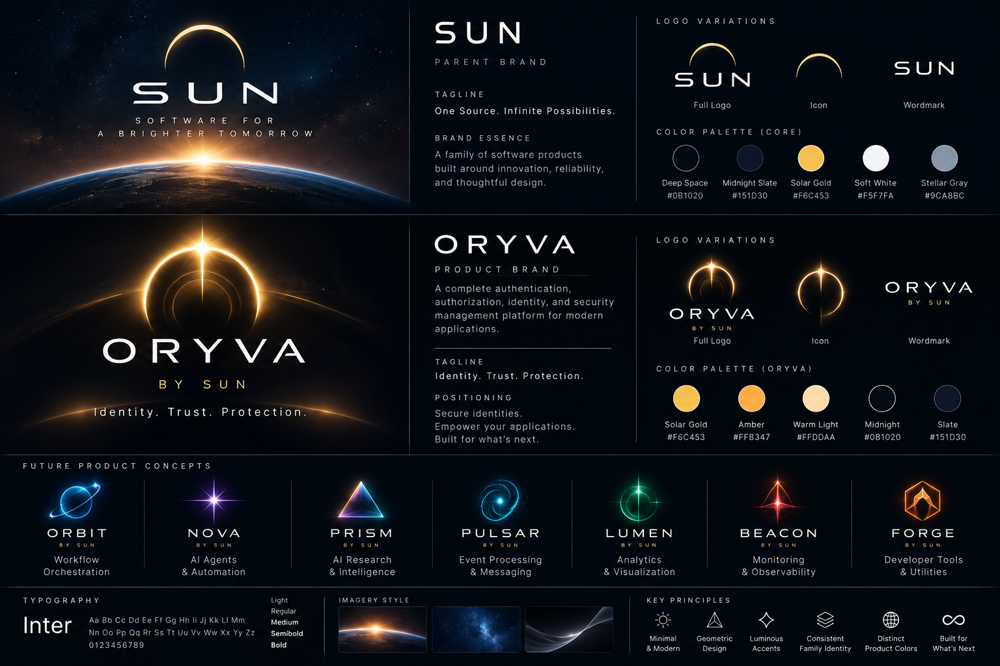

# SUN × Outpost — Visual Identity Concept 01

**Status:** CONCEPT / review, not final production logo assets.  
**Date:** 2026-10-30

## Concept board
An initial visual exploration was generated for the SUN parent brand and Outpost by Sun. The concept board includes full logos, icon and wordmark variants, dark celestial compositions, color palette proposals, and visual ideas for seven **unapproved** future names.

**Asset:** [View original concept PNG](assets/refs/a_sleek_high_end_branding_identity_presentation_m.png).

## SUN direction
- Eclipse / sunrise arc above a clean spaced **SUN** wordmark.
- Parent positioning: **One Source. Infinite Possibilities.** (working tagline, not separately approved).
- Deep Space background `#0B1020`, Midnight Slate surface `#151D30`, Solar Gold `#F6C453`, Soft White `#F5F7FA`, Stellar Gray `#9CA8BC`.

## Outpost direction
- Circular protective boundary with a vertical light source, expressing identity and trust.
- **Outpost by Sun** lockup.
- Approved product tagline: **Identity. Trust. Protection.**
- Solar Gold base; amber `#FFB347` and warm light `#FFDDAA` are exploratory secondary accents.

## Important distinctions
- This board predates later product approvals. See the [current product registry](../registry/PRODUCTS.md) for confirmed names.
- ORBIT, NOVA, PRISM, PULSAR, LUMEN, BEACON and FORGE appear as **visual explorations only**, not approved product identities.
- The concept board is an illustrative raster image, not an editable/vector production asset or a completed brand standards package.
- Trademark and logo similarity review, small-size legibility, monochrome variants, and accessibility checks are outstanding.

## Next steps
1. Review SUN and Outpost marks independently.
2. Create precise vector SVG masters and icon variants after selection.
3. Record explicit visual approval and update `branding/VISUAL-IDENTITY.md`.
