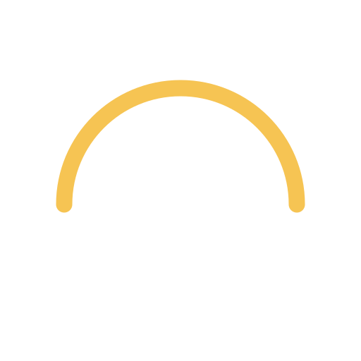

# SUN × ORYVA — Vector Logo Candidates

**Status:** Proposed refinements, awaiting visual approval and conflict clearance.

| Brand | Symbol | Horizontal lockup |
|---|---|---|
| SUN |  |  |
| ORYVA |  |  |

## Specifications
- Masters: transparent SVG with a 512 × 512 icon viewBox or 1050 × 512 lockup viewBox.
- Colors: Solar Gold `#F6C453`; Soft White `#F5F7FA`; intended dark background `#0B1020`.
- SVGs are editable vector artwork; wordmarks use a system sans-serif font and **are not converted to outlines**.
- Icons are illustrative geometry derived from Concept 01, not a literal vectorization of the AI-generated raster concept.
- Do not treat these as final approved trademarks, or as accessibility-tested favicons.

## Export guidance
Render SVGs to PNG at 16, 32, 48, 64, 180, 192, and 512 px for icons; 1024 px wide for lockups. Bundle 16/32/48 px images into `.ico` files. Inspect legibility at 16 px before release.

## Review checklist
- [ ] Select SUN and ORYVA master marks.
- [ ] Check distinctiveness / legal conflicts.
- [ ] Approve optical weights, spacing, and small-size simplifications.
- [ ] Convert wordmark text to paths for portable print masters.
- [ ] Create light-background and monochrome variants.
- [ ] Confirm contrast and favicon legibility.
