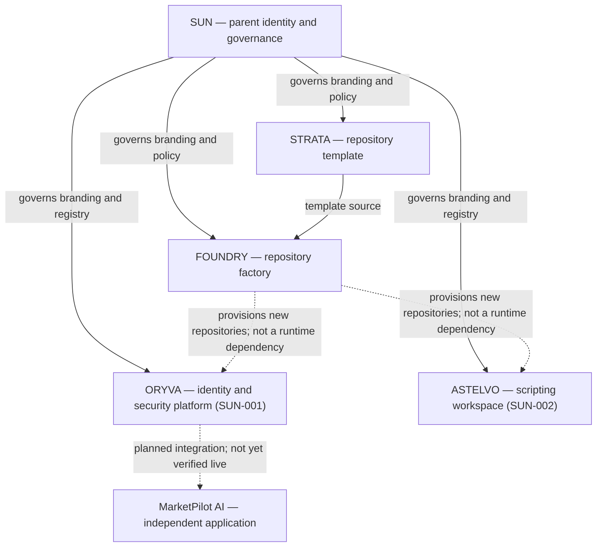

# SUN Ecosystem Map

**Status:** Current organizational relationships, not a deployment diagram.  
**Updated:** 2026-11-14

## Boundaries

- **SUN Ecosystem** is the central authority for portfolio naming, brand guidelines, product registry and governance; it is not an application runtime.
- **STRATA** is a reusable repository template. **FOUNDRY** uses STRATA to provision repositories and apply/verify governance. Neither is a product runtime dependency.
- **ORYVA** and **ASTELVO** are confirmed, independently usable SUN products. Their implementation and delivery status belong in their own repositories.
- **MarketPilot AI** is an independent application and initial planned ORYVA integration target; do not describe it as already powered by ORYVA until verified.
- Dotted links indicate intended or illustrative relationships, **not evidence of historical provisioning or completed integration**.

## Authoritative sources

- [Product registry](../../registry/PRODUCTS.md) and [machine-readable registry](../../registry/products.json)
- [Brand architecture](../../branding/BRAND-GUIDELINES.md)
- [Repository governance](../governance/GIT-WORKFLOW.md)
- [FOUNDRY](https://github.com/sunstriker2009/sun-foundry) and [STRATA](https://github.com/sunstriker2009/sun-strata)
